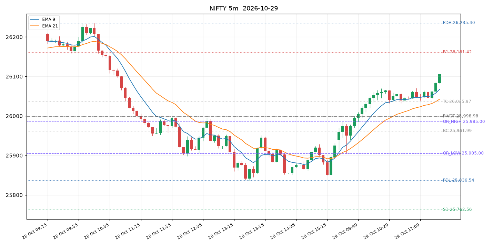
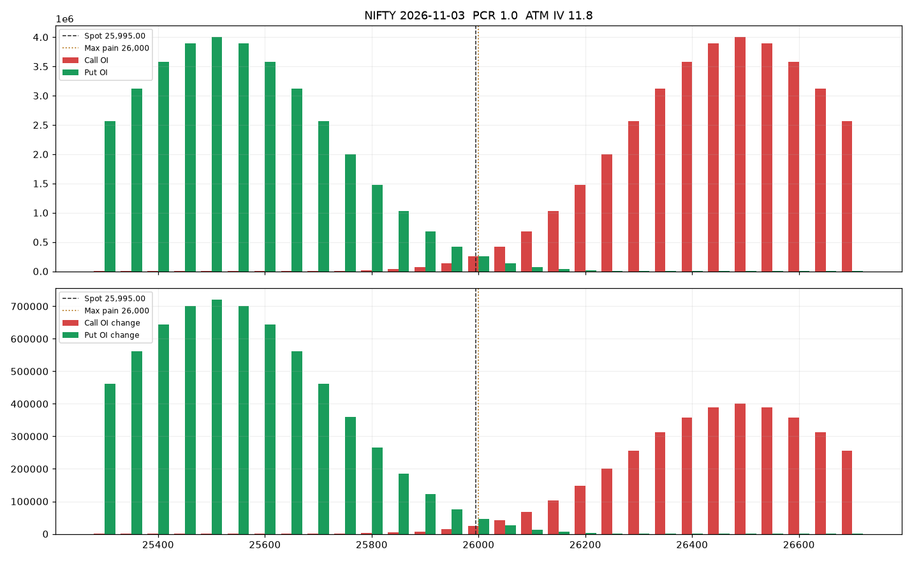
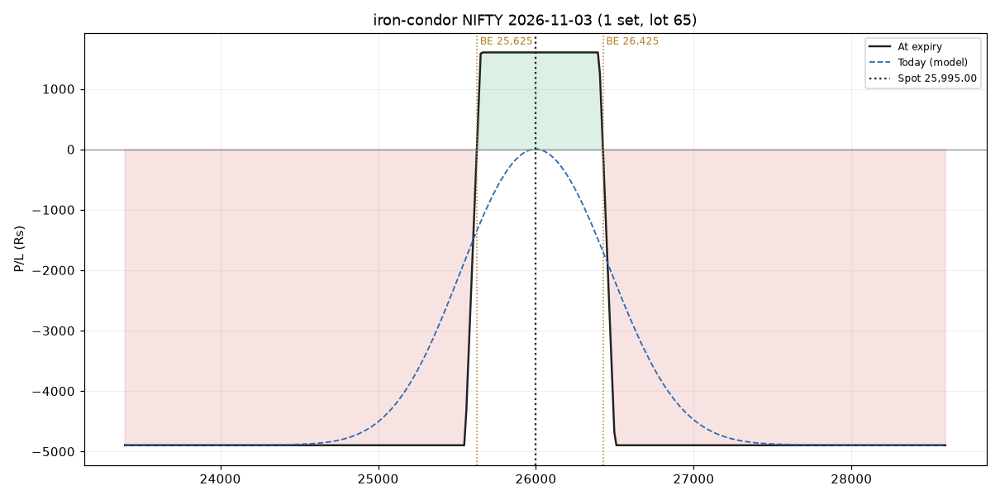
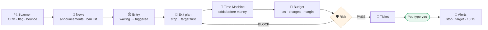
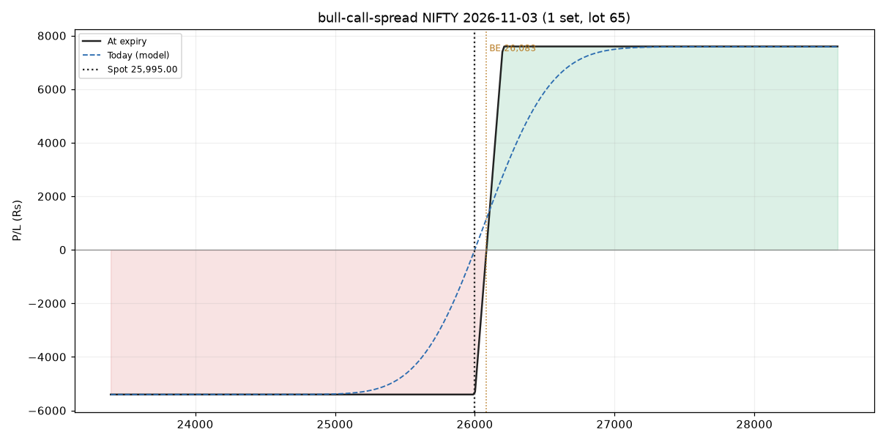
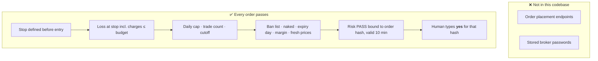
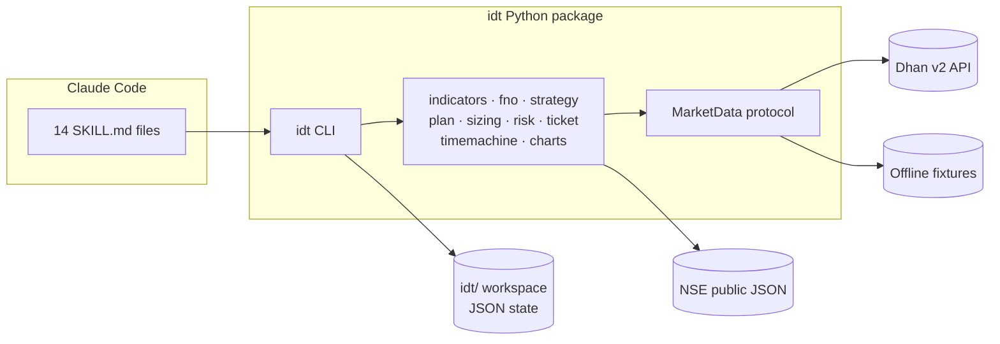

<div align="center">

# 🇮🇳 Indian Day Trader

### Claude skills for intraday trading on NSE & BSE: index charts, option chains, F&O strategies, sizing in lots, a risk gate, and order tickets you place yourself.

[](https://github.com/iamsanaur/indian-day-trader/actions/workflows/ci.yml)


[](LICENSE)



</div>

> [!WARNING]
> **Not investment advice.** SEBI's FY22–FY24 study found that about **9 in 10 individual F&O traders lost money**.
> This project helps you plan and check trades with discipline. It does not make anyone profitable.
> Stops are not guaranteed fills, and market data can lag or be wrong. You are responsible for every order you place.

---

## Contents

- [Why this exists](#-why-this-exists)
- [What you get](#-what-you-get)
- [How a trade flows](#-how-a-trade-flows)
- [Quick start](#-quick-start)
- [Worked example](#-worked-example-nifty-orb--bull-call-spread)
- [Skills reference](#-skills-reference)
- [Option selling](#-option-selling)
- [Safety model](#-safety-model)
- [Charges](#-indian-charges)
- [Configuration](#%EF%B8%8F-configuration)
- [Architecture](#-architecture)
- [Testing](#-testing)
- [Roadmap](#-roadmap)
- [FAQ](#-faq)

---

## 💡 Why this exists

[day-trader-skill](https://github.com/Jakeschincariol/day-trader-skill) showed that Claude can run a
disciplined day-trading checklist: scan, wait for the trigger, set the stop first, size from the loss,
check risk, then ask the human. That pack targets US stocks.

Indian markets work differently:

| | 🇺🇸 Original | 🇮🇳 This project |
|---|---|---|
| Session | 09:30–16:00 ET | **09:15–15:30 IST**, MIS square-off ~15:15–15:20 |
| Main instruments | Stocks | **Index options** (NIFTY, BANKNIFTY, SENSEX…), stock F&O, cash |
| Contract size | 1 share | **Lots** set by the exchanges and revised periodically (NIFTY 65 from January 2026) |
| Restrictions | Pattern-day-trader rule | **F&O ban list**, MIS cutoffs, weekly expiry only on NIFTY and SENSEX |
| Costs | Commission-free | **STT, exchange fees, SEBI fee, stamp duty and GST** on every trade |
| Data | Yahoo, SEC EDGAR | **Dhan v2 API** plus public NSE endpoints |
| Insider tracking | US Congress trades | **Bulk/block deals and SEBI PIT disclosures** |

So this is a rebuild for India rather than a translation, with options as the main instrument.

---

## ✨ What you get

<table>
<tr>
<td width="50%" valign="top">

### 📈 Index charts
NIFTY · BANKNIFTY · FINNIFTY · MIDCPNIFTY · SENSEX · INDIA VIX

Opening range, previous-day high/low/close, CPR and floor pivots, EMA 9/21 trend, and VWAP on
futures. Output as a PNG and an interactive HTML chart.

</td>
<td width="50%" valign="top">

### 🔗 Option chain analytics
OI and change in OI, **PCR**, **max pain**, ATM IV and skew, the expected move from the ATM straddle,
OI walls, fresh call/put writing, buildup per strike, and Greeks.

</td>
</tr>
<tr>
<td valign="top">

### 🧩 Strategy builder
Long/short calls and puts, bull/bear spreads, straddles, strangles, **iron condors**, iron flies, and
custom legs. Shows payoff, breakevens, max P/L, net Greeks and **basket margin**.

</td>
<td valign="top">

### 🛡️ Risk gate
**PASS / BLOCK** on: daily loss cap, trade count, entry cutoff, ban list, naked shorts, expiry-day selling,
margin and stale prices. Every rule must pass before a ticket can be built.

</td>
</tr>
<tr>
<td valign="top">

### 🎲 Time Machine
10,000 seeded Monte Carlo sessions built from real 5-minute bar shapes at the same time of day,
plus a replay of the same rule on prior sessions. Options are repriced with Black-Scholes.

</td>
<td valign="top">

### 🧾 Sizing with Indian charges
Shares or **lots** from your max loss, capped by leverage and margin. STT, exchange, SEBI, stamp duty
and GST are included in the loss at stop.

</td>
</tr>
</table>

<div align="center">


</div>

---

## 🔄 How a trade flows



Each step writes a small JSON file to `idt/` in your project, and the next step reads it:

```
setup.json → strategy.json → plan.json → orders.json → risk.json → ticket → journal.jsonl
```

The risk verdict is tied to a hash of the sized order. If anything changes after the check, the ticket
is refused until you re-run it.

---

## 🚀 Quick start

### 1. Install

```bash
git clone https://github.com/iamsanaur/indian-day-trader.git
cd indian-day-trader
uv tool install .          # or: pip install -e .    (Python 3.10+)
idt init                   # creates idt/config.json and idt/watchlist.json
```

### 2. Connect market data (Dhan)

```bash
export DHAN_CLIENT_ID=1000000000
export DHAN_ACCESS_TOKEN=eyJ...    # web.dhan.co → My Profile → Access DhanHQ APIs
```

> [!NOTE]
> Dhan access tokens expire daily, and the historical, quote and option-chain APIs need Dhan's data
> subscription. Only **read** endpoints are called, and this code contains no order-placement code.

### 3. Add the skills to Claude Code

```bash
# Option A: as a plugin
/plugin            # then add this folder

# Option B: copy the skills
cp -r skills/* ~/.claude/skills/
```

Then ask Claude things like:

> *"How are the indices doing?"* · *"Show me the NIFTY option chain"* · *"Has BANKNIFTY broken its
> opening range?"* · *"Build an iron condor on NIFTY at 15 delta"* · *"Size it for a ₹3,000 max loss and check risk"*

### 4. Try it offline first

The repo ships with deterministic fixtures, so you can run the whole pipeline without an account:

```bash
export IDT_FIXTURES=tests/fixtures/data
idt --now "2026-10-29 09:45" index NIFTY
```

---

## 📒 Worked example: NIFTY ORB → bull call spread

The fixture session is 2026-10-29 at 09:45 IST. NIFTY opens at 25,940, the 15-minute opening range is
**25,905–25,985**, and the 09:35 five-minute bar closes at **25,995**.

```bash
export IDT_FIXTURES=tests/fixtures/data
alias idt='idt --now 2026-10-29T09:45'
idt init                                  # then set "max_loss_per_trade": 3000 in idt/config.json
```

<table>
<tr><th>Step</th><th>Command</th><th>Result</th></tr>
<tr><td>⏱️ Trigger</td><td><code>idt entry check NIFTY --write</code></td><td>✅ triggered long @ 25,995 (OR mid 25,945)</td></tr>
<tr><td>🔗 Chain</td><td><code>idt chain NIFTY</code></td><td>Max pain 26,000 · call wall 26,500 · put wall 25,500 · ATM IV 11.8%</td></tr>
<tr><td>🧩 Strategy</td><td><code>idt strategy bull-call-spread NIFTY --width 4 --write</code></td><td>+26000 CE @ 156.87 / −26200 CE @ 73.73 → debit ₹5,404 · max profit ₹7,596 · BE 26,083</td></tr>
<tr><td>🎯 Plan</td><td><code>idt exit plan --kind strategy --stop maxloss-pct:50 --target 1.5R --write</code></td><td>Stop −₹2,702 · target +₹4,053 per set (1.5 R)</td></tr>
<tr><td>🎲 Odds</td><td><code>idt timemachine run</code></td><td>Target 9.5% · stop 28.4% · still open at 15:15 62.1%</td></tr>
<tr><td>🧮 Size</td><td><code>idt size --write</code></td><td>1 set (65 qty) · loss at stop ₹2,832 incl. ₹130 charges</td></tr>
<tr><td>🛡️ Risk</td><td><code>idt risk check</code></td><td>✅ <b>PASS</b></td></tr>
<tr><td>🧾 Ticket</td><td><code>idt ticket show</code></td><td>BUY 65 × 26000 CE LMT 156.87 → SELL 65 × 26200 CE LMT 73.73</td></tr>
<tr><td>✍️ Confirm</td><td><code>idt ticket confirm &lt;hash&gt;</code></td><td>Logged. You place the order in your broker.</td></tr>
</table>

<div align="center">

</div>

<details>
<summary><b>Same setup as a single long call with the stop on the underlying</b></summary>

```bash
idt exit plan --stop or-mid --target 1.5R --write
# 26000 CE @ 156.87 · stop ≈ 132.04 (when NIFTY hits 25,945) · target ≈ 199.17 (NIFTY 26,070)
# risk ₹1,614 per lot. The premium is repriced with Black-Scholes, anchored to the traded price.
```

</details>

---

## 📚 Skills reference

| Skill | What it does | Key commands |
|---|---|---|
| [`/idt-index`](skills/idt-index/SKILL.md) | Index board, levels, charts | `idt index` · `idt index NIFTY --html` · `--future` |
| [`/idt-options`](skills/idt-options/SKILL.md) | Option chain analytics | `idt chain NIFTY --expiry monthly --chart` · `idt expiries SENSEX` |
| [`/idt-strategy`](skills/idt-strategy/SKILL.md) | Build and analyse strategies | `idt strategy iron-condor NIFTY --delta 0.15` · `custom --leg +1x26000CE` |
| [`/idt-scanner`](skills/idt-scanner/SKILL.md) | ORB · bull flag · oversold bounce | `idt scan orb --universe fno` |
| [`/idt-entry`](skills/idt-entry/SKILL.md) | Waiting / triggered / expired | `idt entry watch NIFTY --write` |
| [`/idt-exit`](skills/idt-exit/SKILL.md) | Stop and target before entry | `idt exit plan --stop or-mid --target 1.5R` |
| [`/idt-timemachine`](skills/idt-timemachine/SKILL.md) | Monte Carlo + replay | `idt timemachine run` |
| [`/idt-budget`](skills/idt-budget/SKILL.md) | Lots, margin, charges | `idt size --write` · `idt charges --segment opt …` |
| [`/idt-risk`](skills/idt-risk/SKILL.md) | PASS / BLOCK | `idt risk check` · `idt status` |
| [`/idt-broker`](skills/idt-broker/SKILL.md) | Broker-neutral ticket | `idt ticket show` · `idt ticket confirm <hash>` |
| [`/idt-alerts`](skills/idt-alerts/SKILL.md) | Stop / target / P&L / square-off | `idt alerts add --from-plan` · `idt alerts watch` |
| [`/idt-news`](skills/idt-news/SKILL.md) | NSE announcements, ban list | `idt news --hours 24` · `idt ban` |
| [`/idt-analyst`](skills/idt-analyst/SKILL.md) | Quarterly results, QoQ/YoY | `idt results TCS` |
| [`/idt-insider`](skills/idt-insider/SKILL.md) | Bulk/block deals, PIT disclosures | `idt insider deals` · `idt insider pit --symbol RELIANCE` |

<details>
<summary><b>Stop and target rules</b></summary>

| Stop rule | Meaning |
|---|---|
| `or-mid` / `or-low` | Opening-range midpoint / far side of the range |
| `atr:K` | K × ATR(14) on 5-minute bars |
| `pct:N` / `price:X` | N% from entry / fixed level |
| `premium-pct:N` | Options: exit if the premium falls N% |
| `maxloss-pct:N` | Strategies: N% of the defined max loss |
| `credit-x:N` | Credit strategies: exit when the loss equals N × the credit |
| `pnl:-X` | Strategies: a fixed rupee loss per set |

Targets: `1.5R`, `pct:N`, `price:X`, `maxprofit-pct:N`, `credit-pct:N`, `pnl:X`.

</details>

<details>
<summary><b>Every CLI command</b></summary>

```
idt init | status
idt index [SYMBOL] [--interval 1|5|15|25|60] [--days N] [--html] [--future]
idt expiries UNDERLYING
idt chain UNDERLYING [--expiry near|next|monthly|YYYY-MM-DD] [--strikes N] [--chart]
idt strategy NAME|custom|list [UNDERLYING] [--lots] [--offset] [--width] [--delta] [--leg …] [--chart] [--write]
idt scan orb|flag|bounce [--universe fno|watchlist|indices|A,B,C] [--limit N]
idt entry check|watch SYMBOL [--setup orb|pdh|level] [--above X] [--below Y] [--write]
idt exit plan [--kind equity|future|option|strategy] [--stop RULE] [--target RULE] [--option CE|PE] [--strike-offset N] [--write]
idt timemachine run [--paths N] [--seed N] [--days N]
idt size [--max-loss X] [--write]
idt risk check
idt ticket show | confirm HASH
idt journal show | close --pnl X
idt alerts add|check|watch|list|clear [--from-plan] [--symbol S --above X --below Y]
idt news [--symbols A,B] [--hours N] · idt ban · idt results SYMBOL · idt insider deals|pit
idt charges --segment eq_intraday|eq_delivery|fut|opt --buy X --sell Y [--exchange NSE|BSE]
idt --now "YYYY-MM-DD HH:MM" <any command>      # replay a past moment
```

</details>

---

## 🪙 Option selling

Short options are supported: `short-straddle`, `short-strangle`, credit spreads, `iron-condor`,
`iron-fly`, and `custom`. They come with these defaults:

- 🚫 **`allow_naked: false`**: uncovered short calls and puts are **blocked**. Defined-risk structures pass.
- 📅 **`block_expiry_day_selling: true`**: no fresh short options that expire the same day (gamma risk).
- 🧮 **Credit stops**: `credit-x:1` exits when the loss equals the credit received. `credit-pct:50` takes profit at half the credit.
- 💰 **Margin**: Dhan's basket margin calculator, with hedge benefit, checked against your available funds.

---

## 🛡️ Safety model



- **Paper mode** is the default.
- Keys are read **only from environment variables**.
- Shorting and naked options are **off** until you turn them on.
- The ticket tells you to place hedge legs before shorts, and to exit shorts first.

---

## 🧾 Indian charges

Rates are effective **1 April 2026**, after the Union Budget 2026-27 raised STT on F&O.

| Segment | STT | Exchange txn (NSE) | Stamp duty (buy) |
|---|---|---|---|
| Equity intraday | 0.025% on sell | 0.00297% | 0.003% |
| Futures | **0.05%** on sell | 0.00173% | 0.002% |
| Options | **0.15%** of premium on sell | 0.03503% of premium | 0.003% |

Plus SEBI's ₹10 per crore and 18% GST on brokerage and fees. Brokerage defaults to ₹20 per order, or
0.03% for intraday equity if that is lower. You can override any rate with `charges_override`. Check the
numbers against your broker's contract note.

```bash
idt charges --segment opt --buy 10196 --sell 12000
# brokerage 40 · STT 18 · exchange 7.78 · SEBI 0.02 · stamp 0.31 · GST 8.6 → total ₹74.71
```

---

## ⚙️ Configuration

`idt/config.json` (see [`config.example.json`](config.example.json)):

| Key | Default | Purpose |
|---|---|---|
| `mode` | `paper` | `live` reads available funds from Dhan |
| `capital` | 100000 | Paper capital (₹) |
| `max_loss_per_trade` | 1000 | Hard cap on loss at stop, including charges |
| `daily_loss_cap` | 3000 | Blocks new trades once realised plus planned loss reaches this |
| `max_trades_per_day` | 5 | Confirmed tickets per day |
| `or_minutes` | 15 | Opening-range length |
| `entry_expiry` / `entry_cutoff` / `squareoff` | 11:30 / 15:00 / 15:15 | IST times |
| `allow_short` / `allow_naked` | false / false | Permissions |
| `block_expiry_day_selling` | true | No same-day-expiry short options |
| `min_premium` | 5 | Avoid illiquid, far-OTM premiums |
| `stale_quote_seconds` | 60 | Price freshness for the risk check |
| `charges_override` | `{}` | Patch any rate |
| `index_ids` | `{}` | Override Dhan index security IDs |

---

## 🏗️ Architecture



```
src/idt/
├── data/          base.py (types + MarketData) · dhan.py · instruments.py · nse.py · fixture.py
├── indicators.py  EMA, RSI, ATR, VWAP, opening range, CPR/pivots
├── fno.py         Black-Scholes, IV, Greeks, PCR, max pain, buildup, OI walls
├── strategy.py    legs, payoff, breakevens, builders, naked detection
├── plan.py        stop/target rules → risk per unit
├── sizing.py      lots, margin, charges, order hash
├── risk.py        PASS/BLOCK rules
├── ticket.py      broker-neutral ticket
├── timemachine.py Monte Carlo + replay
├── charts.py      matplotlib PNG + plotly HTML
└── cli.py         `idt` command
skills/idt-*/SKILL.md
```

The data layer is **pluggable**. To support another broker (Zerodha Kite, Upstox, Angel One),
implement the `MarketData` protocol in one file.

---

## 🧪 Testing

```bash
uv pip install -e ".[dev]"
pytest -q                                   # 44 tests, offline, under a second
python tests/fixtures/make_fixtures.py      # regenerate deterministic fixtures
```

The tests cover Black-Scholes reference values, put-call parity, IV round trips, payoffs and
breakevens, charges, sizing in lots, every risk rule, ticket hash and expiry, Time Machine
determinism, Dhan request/response mapping and error handling (mocked HTTP), and the full worked
example end to end.

---

## 🗺️ Roadmap

- [x] 14 skills, Dhan adapter, offline fixtures, CI
- [ ] Self-hosted API server (FastAPI) for the apps
- [ ] Web app (React + Vite)
- [ ] Native iOS (SwiftUI) and Android (Jetpack Compose) apps
- [ ] More data adapters: Zerodha Kite, Upstox, Angel One
- [ ] Websocket live ticks for alerts

---

## ❓ FAQ

<details>
<summary><b>Can it place trades automatically?</b></summary>

No. There is no order-placement code. The most it does is print a ticket and log your confirmation.
Automated order placement in India also comes with SEBI and exchange rules on algo trading, so that is
deliberately out of scope.
</details>

<details>
<summary><b>Why Dhan?</b></summary>

It has a native option-chain endpoint with Greeks, a basket margin calculator, and a plain REST
interface. The design is broker-agnostic, so other adapters are welcome.
</details>

<details>
<summary><b>Are lot sizes hardcoded?</b></summary>

No. Lot sizes, tick sizes and expiries are read from Dhan's instrument master every day, because
NSE and BSE revise them (NIFTY went from 75 to 65 in January 2026).
</details>

<details>
<summary><b>Is the Time Machine a backtest?</b></summary>

It is a simulation built from about 60 sessions of 5-minute bars, plus a replay of the same rule on those
sessions. It shows the shape of the risk, not a forecast. Event days (RBI policy, the budget, results,
expiry) behave differently.
</details>

<details>
<summary><b>How is F&O taxed?</b></summary>

Intraday equity profits are speculative business income. F&O profits are non-speculative business
income. This is not tax advice; ask a chartered accountant.
</details>

---

## 🤝 Contributing

Issues and PRs are welcome. See [CONTRIBUTING.md](CONTRIBUTING.md). Good first contributions:
a new broker adapter, a new scanner setup, or more realistic margin estimates.

## 🙏 Credits

Inspired by [Jakeschincariol/day-trader-skill](https://github.com/Jakeschincariol/day-trader-skill).
Market data from [DhanHQ](https://dhanhq.co/docs/v2/) and public NSE pages.

## 📄 License

[MIT](LICENSE). Use it, fork it, learn from it, and trade responsibly.
